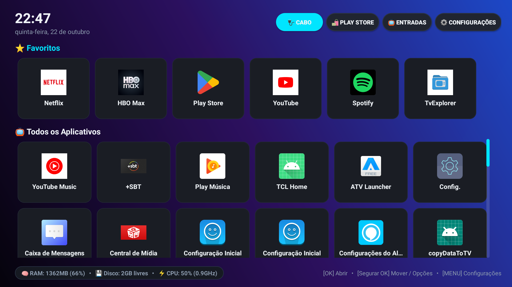
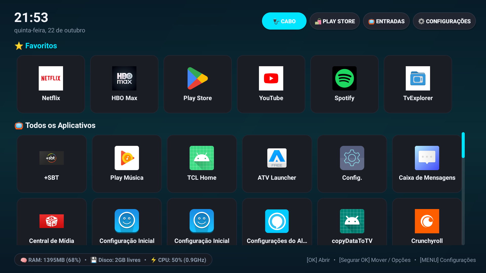
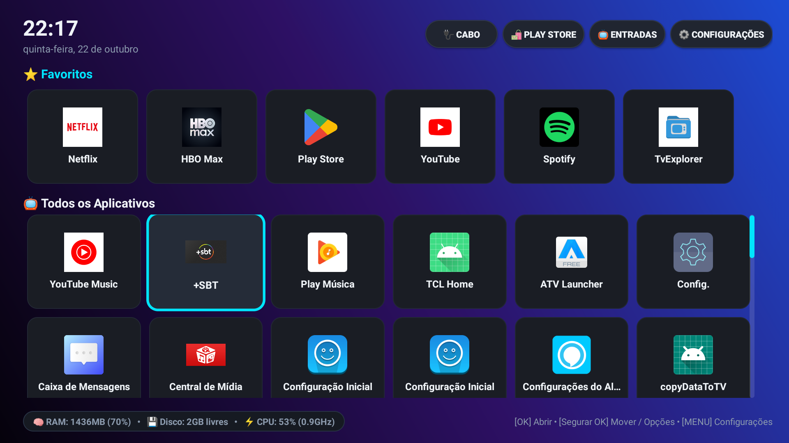
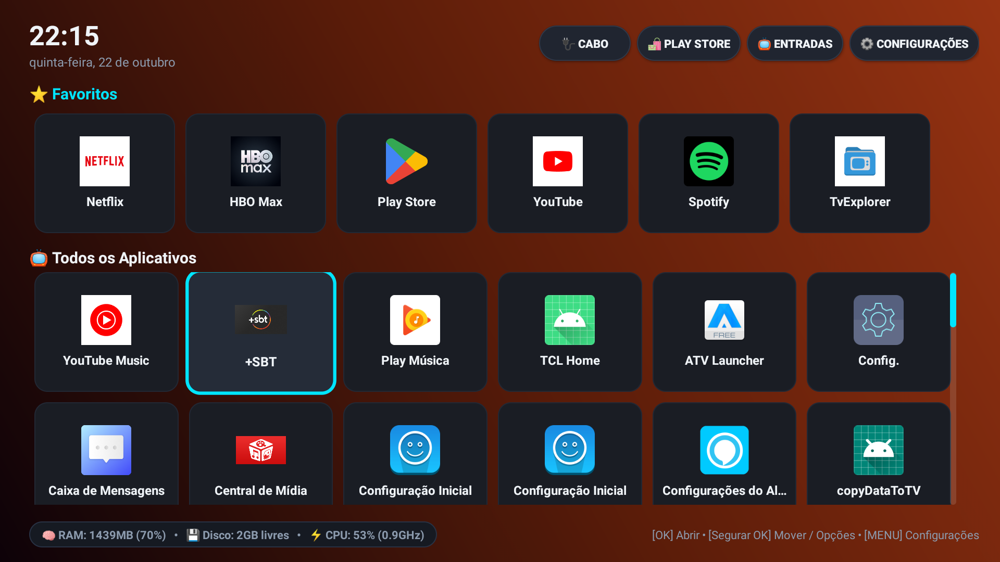
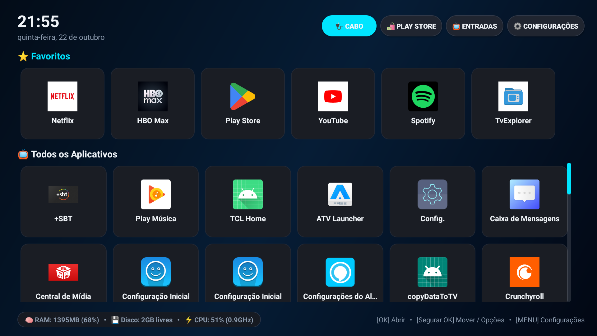
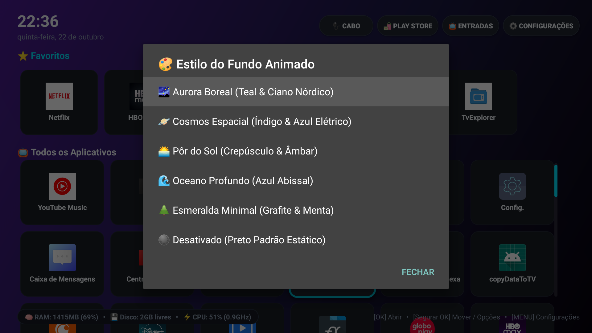

# NanoTV Launcher 📺⚡
> **Ultra-lightweight, bloat-free & ad-free launcher for Android TV (crafted especially for TCL 50P8M, low-RAM Smart TVs and TV boxes).**  
> *Launcher ultraleve, moderno e sem anúncios para Smart TVs Android (com foco especial na linha TCL / 50P8M e dispositivos de hardware modesto).*



<div align="center">

**[🇧🇷 Versão em Português](#-versão-em-português)** | **[🇺🇸 English Version](#-english-version)**

</div>

---

# 🇧🇷 Versão em Português

## 💡 Por que este projeto existe?

Muitas Smart TVs Android (como a **TCL 50P8M**, modelos Philips, Philco e diversas TV Boxes) possuem hardware modesto: processadores quad-core de baixo consumo e **apenas 2 GB de memória RAM**. 

O launcher padrão oficial do Google TV e as customizações de fábrica dessas TVs pesam excessivamente no sistema:
* **Google TV Launcher:** consome até **90% de CPU** em picos e mais de **250 MB de RAM**, carregando trailers de vídeo automáticos, propagandas e sincronização contínua de canais patrocinados em segundo plano.
* **Telemetria de Fábrica:** serviços em segundo plano (como *TCL BI*, *Waterfall Ads*, *TV Guard*) competem pela CPU e causam engasgos severos, congelamentos no controle remoto e lentidão ao abrir aplicativos.

O **NanoTV Launcher** foi desenvolvido em **Java e Views nativas puras (XML + RecyclerView)**, sem bibliotecas pesadas de runtime, trazendo a TV de volta à fluidez instantânea que ela deveria ter.

---

## ✨ Recursos Principais (Versão 1.2.0)

* 🎨 **Fundo Gradiente Animado Fluido (Aceleração por GPU / 0% CPU):** Transição contínua e suave de iluminação ambiente com 5 temas modernos e rotação orbital em 4 fases (`🌌 Aurora Boreal`, `🪐 Cosmos Espacial`, `🌅 Pôr do Sol`, `🌊 Oceano Profundo`, `🌲 Esmeralda Minimal`) ou opção `🌑 Desativado` (fundo preto fosco original). Configurável diretamente pelo menu de Configurações da TV sem gerar nenhum engasgo ou aumento no uso de CPU.
* ⚡ **0% de Uso de CPU em Repouso:** A interface é acelerada por hardware de forma ultra-otimizada, liberando os núcleos do processador para os seus filmes e vídeos.
* 🧠 **Uso Mínimo de RAM (< 20 MB):** Redução de mais de **90%** comparado ao launcher oficial do Google.
* 🚀 **Otimizador de Memória RAM Integrado no Rodapé:** Badge interativo no rodapé que mostra o consumo em tempo real de **RAM**, **Espaço em Disco** e **CPU**. Ao selecionar o badge com as setas do controle e pressionar **[OK]**, abre o menu de desempenho com a opção de **Liberar Memória RAM** (encerrando processos e serviços não essenciais em segundo plano).
* ⚡ **Medição Real e Dinâmica de CPU:** Leitura nativa e precisa da frequência do processador (em GHz) e carga do governor via sysfs do kernel Linux, corrigindo a limitação do Android 9 Pie (SELinux) onde ferramentas convencionais ficavam travadas em 0%.
* 🔀 **Modo Mover Fluido (Organizar com Setas):** Ao segurar [OK] e escolher "Mover Aplicativo", o card entra em destaque dourado e você pode reposicioná-lo livremente usando as setas do controle (**Cima, Baixo, Esquerda, Direita**) quantas casas quiser continuamente. Basta pressionar **[OK]** ou **[VOLTAR]** para fixar e salvar a posição para sempre.
* 🗑️ **Desinstalação Inteligente de Aplicativos:** Suporte direto à desinstalação de apps de terceiros via tela nativa do sistema. Caso o app selecionado seja pré-instalado de fábrica (sistema), o launcher avisa e abre diretamente os Detalhes do App nas Configurações para desativar ou limpar dados.
* 🔌 **Indicador de Conexão com a Internet:** Identifica automaticamente se a TV está conectada via **Cabo (Ethernet)** ou **Wi-Fi** (com o nome da rede). Ao clicar nele com o controle, abre diretamente a tela de conexões da TV.
* 🛍️ **Acesso Rápido à Loja de Apps:** Botão no topo que detecta e abre diretamente a **Google Play Store** (ou loja nativa/alternativa da sua TV) em um único clique.
* 🎛️ **Seletor Real de Entradas Físicas:** Menu limpo com as portas reais de hardware (**HDMI 1**, **HDMI 2**, **HDMI 3**, **AV** e **TV Aberta/Antena**).
* ⭐ **Linha de Favoritos:** Fixe os seus aplicativos mais usados no topo com rolagem horizontal fluida.
* 📱 **Suporte Completo a Apps Sideload:** Exibe todos os aplicativos instalados, inclusive aqueles que o Android TV padrão esconde por não terem banner de TV.
* 📜 **Barra de Rolagem Proporcional:** Indica com exatidão a quantidade real de apps fora da tela com espaçamento arejado, sem sobrepor os cards.
* 🚫 **Zero Propagandas e Zero Telemetria:** Nenhuma conexão externa desnecessária.

---

### 🎨 Galeria dos Temas de Fundo Animado

| 🌌 Aurora Boreal | 🪐 Cosmos Espacial | 🌅 Pôr do Sol |
| :---: | :---: | :---: |
|  |  |  |

| 🌊 Oceano Profundo | ⚙️ Menu de Seleção | 📺 Rolagem Nativa Estável |
| :---: | :---: | :---: |
|  |  |  |

---

## 🏠 Como Definir o NanoTV como Launcher Padrão (Sem Ficar Perguntando)

Por padrão, o Android TV tenta forçar o retorno ao launcher original da Google toda vez que a tecla **HOME** é pressionada, exibindo uma caixa de seleção *"Concluir a ação usando..."* repetidamente. 

Para tornar o **NanoTV Launcher a tela inicial definitiva e permanente**, utilize um dos métodos abaixo:

### Método 1: Automático em 1 Clique (Recomendado)
Se você utilizar o nosso script de otimização, ele já realiza todo esse processo automaticamente sem você precisar digitar comandos:
1. Conecte o computador e a TV na mesma rede local.
2. Na pasta `scripts/`, execute **`optimize_tcl.bat`** (no Windows) ou **`optimize_tcl.ps1`** (PowerShell).
3. Digite o endereço IP da TV. Pronto! O NanoTV será configurado como padrão e o launcher pesado do Google será desativado.

---

### Método 2: Manual via Comandos ADB

Se preferir fazer diretamente pelo terminal:

```bash
# 1. Conectar na TV via ADB (substitua pelo IP da sua TV)
adb connect SEU_IP_AQUI:5555

# 2. Definir o NanoTV como o Launcher padrão oficial do sistema
adb shell cmd package set-home-activity com.nanotv.launcher/.MainActivity

# 3. Desativar o launcher original da Google (Essencial para não pedir confirmação)
adb shell pm disable-user --user 0 com.google.android.tvlauncher
adb shell pm disable-user --user 0 com.google.android.tvrecommendations

# 4. Enviar sinal do botão Home para abrir o NanoTV imediatamente
adb shell input keyevent KEYCODE_HOME
```

> **Por que é necessário desativar o pacote da Google?**  
> No Android TV, o launcher de fábrica possui uma prioridade rígida no sistema. Ao executar `pm disable-user`, o Android TV reconhece o NanoTV Launcher como a **única tela inicial existente**, eliminando a caixa de seleção e impedindo que os processos pesados do Google continuem consumindo memória e CPU em segundo plano.  
> *(Esse procedimento é 100% reversível e seguro; nada é deletado permanentemente).*

---

### Método 3: Pelo Controle Remoto (Sem Computador)

1. Instale o APK do NanoTV na TV (via pen drive ou app tipo *Send Files to TV*).
2. Pressione a tecla **HOME** (ícone da casinha) no controle remoto.
3. Na janela que aparecer (*"Concluir a ação usando..."*):
   * Selecione **NanoTV Launcher**.
   * Escolha a opção **SEMPRE** (Always).

---

## 🚀 Guia de Instalação Completa

### Pré-requisitos:
1. TV e computador conectados na **mesma rede local** (via Wi-Fi ou Cabo de rede).
2. Ter o [ADB (Android Debug Bridge)](https://developer.android.com/tools/releases/platform-tools) instalado no computador.

### Passo 1: Ativar a Depuração USB na TV
1. Na sua TV, vá em **Configurações** ➔ **Preferências do dispositivo** ➔ **Sobre**.
2. Desça até a opção **Número da Versão** (ou *Build*) e pressione a tecla **[OK] 7 vezes seguidas** até aparecer a mensagem *"Você agora é um desenvolvedor"*.
3. Volte um menu, entre em **Opções do desenvolvedor** e ative a chave **Depuração USB** (ou *Network Debugging*).

### Passo 2: Descobrir o IP da sua TV
* Na TV, vá em **Configurações** ➔ **Rede e Internet** ➔ selecione a sua conexão atual para ver o endereço IP (exemplo: `192.168.1.100`).

### Passo 3: Executar a Otimização
1. Baixe a versão mais recente em [Releases](../../releases) deste repositório e descompacte os arquivos.
2. No Windows, entre na pasta `scripts` e dê dois cliques em **`optimize_tcl.bat`**.
3. Digite o IP da sua TV e dê Enter.
4. **Olhe para a tela da TV:** aparecerá uma caixa de diálogo perguntando *"Permitir depuração USB?"*. Marque a caixa **"Sempre permitir a partir deste computador"** e selecione **OK** com o controle.
5. O script irá instalar o APK, defini-lo como padrão, desativar telemetrias e ajustar a velocidade das animações para `0.5x`.

---

## 🔄 Como Reverter para o Padrão de Fábrica (Se desejar)

Se você quiser desfazer as alterações e voltar para o launcher oficial do Google:

### Opção 1: Pelo Script Automático
1. Na pasta `scripts`, execute **`restore_tcl.bat`** (ou `restore_tcl.ps1`).
2. Digite o IP da TV e pressione Enter. Tudo será restaurado ao estado original de fábrica.

### Opção 2: Manualmente via ADB
```bash
# 1. Reabilitar o launcher e recomendações do Google
adb shell pm enable com.google.android.tvlauncher
adb shell pm enable com.google.android.tvrecommendations

# 2. Definir o Google TV novamente como padrão
adb shell cmd package set-home-activity com.google.android.tvlauncher/.MainActivity

# 3. Reativar telemetria e serviços de fábrica da TCL
adb shell pm enable com.tcl.bootadservice
adb shell pm enable com.tcl.bi
adb shell pm enable com.tcl.waterfall.overseas
adb shell pm enable com.tcl.tvweishi
adb shell pm enable com.tcl.appmarket2

# 4. Restaurar escalas de animação para 1.0x
adb shell settings put global window_animation_scale 1.0
adb shell settings put global transition_animation_scale 1.0
adb shell settings put global animator_duration_scale 1.0

# 5. Iniciar a tela inicial original
adb shell am start -n com.google.android.tvlauncher/.MainActivity
```

---
---

# 🇺🇸 English Version

## 💡 Why Does This Project Exist?

Many Android Smart TVs (such as **TCL 50P8M**, Philips, Philco and numerous TV boxes) come with modest hardware: entry-level quad-core processors and **only 2 GB of RAM**.

The official stock Google TV launcher and OEM factory skins heavily overload these TVs:
* **Google TV Launcher:** spikes up to **90% CPU** and consumes over **250 MB of RAM**, continuously loading video trailers, advertisements, and background sponsored content streams.
* **Factory Telemetry & Bloatware:** OEM services (such as *TCL BI*, *Waterfall Ads*, *TV Guard*) constantly compete for CPU cores, causing severe stuttering, remote control lag, and delays when opening apps.

**NanoTV Launcher** was built from scratch in **pure native Java & Views (XML + RecyclerView)** without heavy runtime frameworks, restoring the instant fluidity your TV was meant to deliver.

---

## ✨ Key Features (v1.2.0)

* 🎨 **Fluid Animated Gradient Background (GPU Accelerated / 0% CPU):** Seamless and continuous ambient lighting transitions featuring 5 modern cinematic themes with 4-phase orbital light circulation (`🌌 Northern Lights`, `🪐 Deep Space Cosmos`, `🌅 Sunset Twilight`, `🌊 Abyssal Deep Ocean`, `🌲 Minimal Emerald`) or `🌑 Disabled` (original matte black). Fully configurable directly via the TV Settings menu with zero impact on system responsiveness or CPU usage.
* ⚡ **0% Idle CPU Usage:** Clean, hardware-accelerated rendering that frees up processor cores for video decoding and streaming.
* 🧠 **Ultra-Low Memory Footprint (< 20 MB RAM):** Over **90% reduction** compared to the stock Google TV launcher.
* 🚀 **Interactive RAM Cleaner in Footer:** Dedicated hardware badge in the footer displaying real-time **RAM**, **Free Storage**, and **CPU**. Navigating down to the badge with remote arrow keys and pressing **[OK]** opens the Performance Manager with a 1-click **Free RAM** feature (terminating non-essential background processes).
* ⚡ **Accurate Dynamic CPU Load & Clock:** Native sysfs kernel monitoring showing real clock speed (in GHz) and dynamic governor load, resolving the Android 9 Pie SELinux restriction where traditional tools showed 0%.
* 🔀 **Fluid Arrow-Key Move Mode:** Hold [OK] and select "Move App" to enter edit mode highlighted in gold. Move apps continuously in all 4 directions (**Up, Down, Left, Right**) across rows and columns. Press **[OK]** or **[BACK]** to lock and save the layout permanently across reboots.
* 🗑️ **Smart App Uninstallation:** Seamless uninstallation of user apps via native `ACTION_DELETE`. For pre-installed factory system apps, NanoTV displays a helpful prompt and opens the app's system details directly so you can disable or clear data.
* 🔌 **Active Network Status Indicator:** Shows whether the TV is connected via **Ethernet (Cable)** or **Wi-Fi** (with network SSID). Clicking it opens the network connection settings instantly.
* 🛍️ **Direct App Store Shortcut:** Header button that detects and launches the **Google Play Store** (or native OEM/sideload store) in a single click.
* 🎛️ **Physical Hardware Inputs Selector:** Clean menu listing real inputs (**HDMI 1**, **HDMI 2**, **HDMI 3**, **AV**, and **Live Antenna TV**).
* ⭐ **Favorites Row:** Pin your most frequently used apps to the top row with smooth horizontal scrolling.
* 📱 **Full Sideload Support:** Automatically discovers and displays all installed apps, including sideloaded mobile apps hidden by stock Android TV.
* 📜 **Airy & Proportional Scrollbar:** Shows the exact position of hidden apps with generous padding and sleek design without overlapping app cards.
* 🚫 **Zero Ads & Zero Telemetry:** Pure local operation with zero background tracking.

---

### 🎨 Animated Background Themes Gallery

| 🌌 Northern Lights | 🪐 Deep Space Cosmos | 🌅 Sunset Twilight |
| :---: | :---: | :---: |
|  |  |  |

| 🌊 Abyssal Deep Ocean | ⚙️ Selection Menu | 📺 Stable Native Grid |
| :---: | :---: | :---: |
|  |  |  |

---

## 🏠 How to Set NanoTV as Default Launcher (Without Being Asked Every Time)

By default, Android TV attempts to return to Google TV every time the **HOME** button is pressed. To set **NanoTV Launcher as the permanent home screen**, use one of the methods below:

### Method 1: Automated 1-Click Script (Recommended)
1. Connect your PC and TV to the same local network.
2. In the `scripts/` folder, run **`optimize_tcl.bat`** (Windows) or **`optimize_tcl.ps1`** (PowerShell).
3. Type your TV's IP address and hit Enter. NanoTV will be installed, set as the default launcher, and stock bloatware will be disabled.

---

### Method 2: Manual ADB Commands

Run the following commands in your terminal:

```bash
# 1. Connect to your TV via ADB (replace with your TV's IP address)
adb connect YOUR_TV_IP:5555

# 2. Set NanoTV as the official default Home activity
adb shell cmd package set-home-activity com.nanotv.launcher/.MainActivity

# 3. Disable the stock Google launcher (Prevents the chooser dialog from popping up)
adb shell pm disable-user --user 0 com.google.android.tvlauncher
adb shell pm disable-user --user 0 com.google.android.tvrecommendations

# 4. Trigger the Home button to open NanoTV immediately
adb shell input keyevent KEYCODE_HOME
```

> **Why disable the Google TV package?**  
> On Android TV, the stock launcher has high priority. Disabling it makes Android recognize NanoTV Launcher as the **only available home screen**, completely eliminating the prompt dialog and stopping Google processes from consuming RAM in the background. *(This is 100% reversible and safe).*

---

### Method 3: Using the Remote Control (No Computer Required)

1. Install the NanoTV APK on your TV (via USB drive or *Send Files to TV*).
2. Press the **HOME** button on the remote control.
3. When the *"Complete action using"* dialog appears:
   * Select **NanoTV Launcher**.
   * Choose **ALWAYS**.

---

## 💻 Building from Source

This project is built using Android Studio with standard Gradle:
1. Clone this repository:
   ```bash
   git clone https://github.com/mateuspaulo/nanotv-launcher.git
   ```
2. Open the project folder in **Android Studio**.
3. Build the debug APK via terminal:
   ```bash
   ./gradlew assembleDebug
   ```
4. Output APK location: `app/build/outputs/apk/debug/app-debug.apk`.

---

## 📄 License

Distributed under the **MIT** License. See `LICENSE` for more information.
Feel free to contribute, submit issues, and fork for other TV models!
